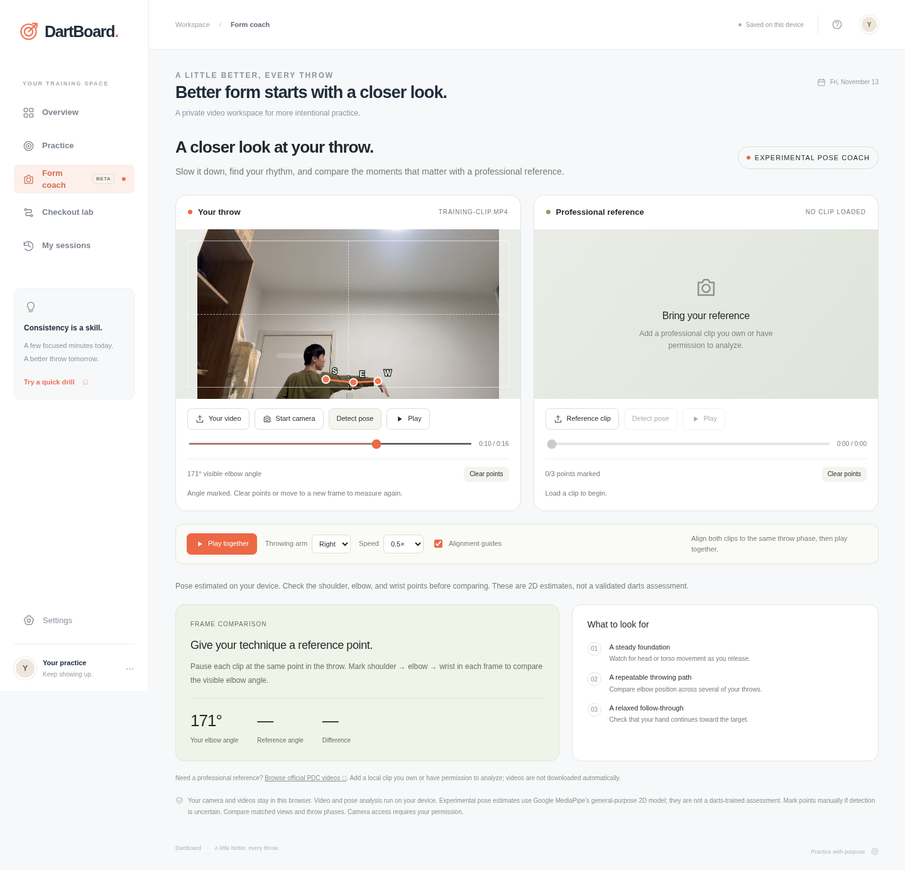

# DartBoard

Train your accuracy, plan double-out finishes, and review your throwing motion. DartBoard runs on your computer; an OpenAI-hosted site is optional.

## Run locally

[Download the repository ZIP](https://github.com/Snowsweater/DartBoard/archive/refs/heads/main.zip), extract it, and keep the folder intact. Install Node.js 20 or newer, then run:

```sh
cd DartBoard-main
npm start
```

Open **http://localhost:4173/local.html**. No account, package installation, or OpenAI hosting is required. The server listens only on your computer. Stop it with Ctrl+C.

The included [local.html](local.html) contains the core interface, styles and application logic. Camera/ML features use the bundled `dist/assets/` files, so download the whole repository. Local mode makes no Google Fonts request. Camera and pose review should use localhost; directly double-clicking the HTML file depends on browser file-access policy and was blocked by the managed browser used for verification.

## Exhibition: your training video

[](docs/showcase/README.md)

**A real 16.17-second clip, analyzed with DartBoard's pose model.** Of 161 sampled frames, 24 passed the right-arm landmark gate (14.9%). Selected visible elbow estimates were **90° at 7.50 s**, **78° at 7.70 s**, and **171° at 10.80 s**. Rejected frames remain gaps.

These measurements show bent and extended arm positions. They do not prove correct posture. The rear-oblique camera view limits joint estimates, and the absent dartboard prevents hit-rate or score analysis. No professional reference was supplied.

**[Read the video exhibition →](docs/showcase/README.md)** · [Watch the clip](docs/showcase/training-clip.mp4) · [Measurement excerpt](docs/showcase/measurements.csv) · [Browser/camera verification](docs/VERIFICATION.md)

## Use

- **Overview:** clearly labeled example sessions until the first real practice is saved; real scoring, hit-rate and practice-duration summaries thereafter.
- **Practice:** select an exact target and 30/60/90 darts, or play 501/301/101 double-out. Log the segment actually hit using the board or number pad. Undo the last dart, resume after reloading, finish and save.
- **Checkout lab:** routes with 1–3 darts, alternative finishes, and setup visits. Bull counts as a double. Busts reset the whole visit.
- **Form coach:** local video or camera capture, independent timelines, synchronized slow motion, and uploaded professional reference clips. Detect shoulder/elbow/wrist with the self-hosted MediaPipe Pose Landmarker, or mark points manually. Compare visible elbow angles from matched frames.
- **My sessions:** history, per-dart details, filtering and CSV export.

## Privacy and limits

Sessions and preferences use browser localStorage. They do not sync between devices. CSV export provides a summary backup. Videos loaded into the app remain local and are released when leaving the coach; they are not uploaded or retained. The exhibition clip and screenshots are published separately with the contributor’s permission. Camera access starts only after an explicit action and browser permission.

The experimental MediaPipe model estimates general-purpose pose landmarks. It has **not** been trained or validated on professional darts footage. A 2D elbow-angle difference is an observation, not an assessment of correct posture. Match camera angle, handedness and throw phase; check landmark placement. Detection rejects arm landmarks with visibility below 0.6 and falls back to manual marking.

Professional clips are supplied by the visitor. The app links to the official PDC video library for discovery, and does not copy or train on those videos. A production darts-specific coaching model needs permitted footage, phase/landmark labels, representative amateur recordings, and validation against qualified coaches. See `dist/assets/SOURCES.txt` for model and SDK provenance.

## Develop and verify

The static website remains in `dist/` and can be served by any HTTPS static host. The generated local page is maintained from the same source:

```sh
npm run build:local
npm test
npm run check
```

The app and local server need no npm packages. Browser testing uses Playwright separately; see [verification instructions](docs/VERIFICATION.md). Tests cover checkout routes for every score 2–170 with 1–3 darts, busts, analytics, local bundling, MIME types, video ranges and server path restrictions.

Changes to `dist/` should be followed by `npm run build:local` and a commit of the regenerated `local.html`.
