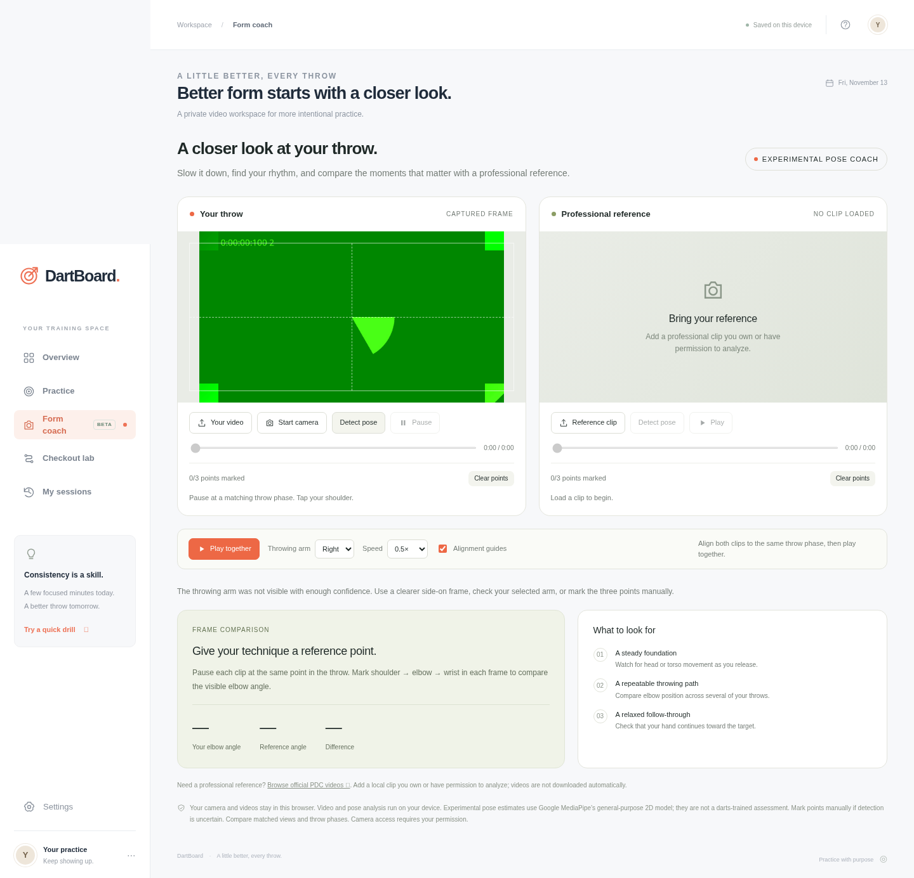

# Browser and camera verification

Verified on **2026-11-13**, using Chromium **156.0.8078.79**, Playwright **1.65.0**, and Node **24.22.1** on Linux.

The browser regression suite completed with **10 passed, 0 failed, 1 environment-blocked**. [Browser report](verification/browser-report.json).

## Verified behavior

| Area | Evidence |
| --- | --- |
| Accuracy practice | Log T20/S20/miss, undo, reload/resume, save; correct 50% hit rate and 120 three-dart average for the saved two-dart session |
| History and CSV | Saved session appears; export includes measured session values |
| Checkout lab | Routes for 121, 170 and 32; bogey 169 setup; invalid-score guard |
| Double-out | Whole-visit bust reset, D16 finish, conventional bust-average denominator |
| Mobile | Navigation and no horizontal overflow at 390 × 844 |
| No camera | Native browser `NotFoundError` produces upload fallback |
| Permission denied | Native browser `NotAllowedError` produces permission-denied guidance |
| Camera lifecycle | Synthetic stream starts; freeze creates an image and ends tracks; stop and navigation end tracks |
| Local HTML | Core flows work at localhost; camera lifecycle also works |
| Local ML assets | Bundled SDK, WASM and model load successfully; nonhuman synthetic frame is rejected |
| Errors | Browser suite had no unexpected console/page errors |

[](verification/local-camera-model.png)

The camera image above is Chromium's **synthetic test feed**. It verifies the capture workflow and model-loading behavior, not a person's posture or a physical webcam's image quality.

## Boundaries of verification

- **Physical camera:** unavailable in the managed test environment. Real-device permissions, lighting, lens quality and camera drivers still depend on the visitor's machine.
- **Direct file opening:** `file://` navigation was blocked by managed Chromium policy (`ERR_BLOCKED_BY_ADMINISTRATOR`). No policy workaround was used. The supported, verified launch path is `npm start` → `http://localhost:4173/local.html`.
- **Browser coverage:** Chromium desktop and a mobile viewport were exercised. Safari, Firefox and physical mobile devices were not tested.
- **Model quality:** this validates execution and rejection behavior, not darts-specific coaching accuracy. The model is general-purpose and has not been trained or validated on professional darts footage.
- **Storage:** localStorage belongs to each browser/origin. A hosted-site session does not automatically appear in the localhost version.

## Repeat the checks

The app itself needs no package installation. For browser test tooling, install the locked development dependency and use an existing Chrome/Chromium executable:

```sh
npm ci
npm test
npm run check
CHROMIUM_PATH=/path/to/chrome npm run test:browser
```

The default executable is `/usr/bin/chromium`. On Windows, set `CHROMIUM_PATH` using the shell's environment-variable syntax. `test:browser` writes its report and screenshots to ignored `work/`.

The local-server tests check the generated HTML's JavaScript syntax, absence of remote font requests, model/WASM MIME types, video byte ranges, HEAD requests, HTTP methods, traversal rejection and symlink boundaries. `local.html` is regenerated by `npm start`, `npm run build:local`, and the local test.
