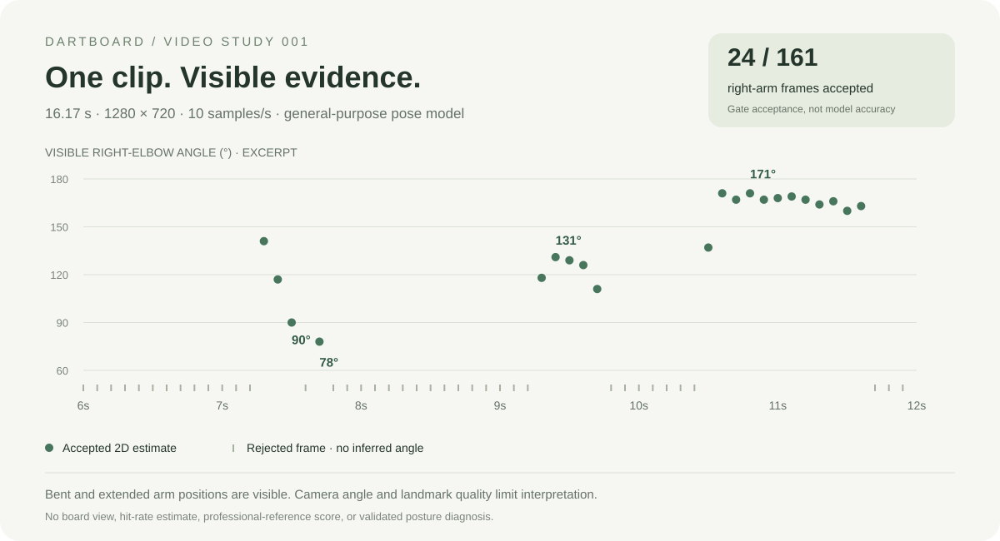
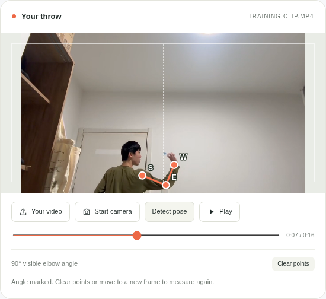
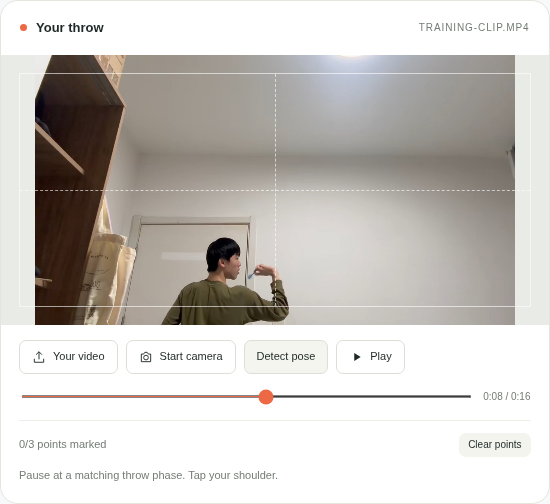
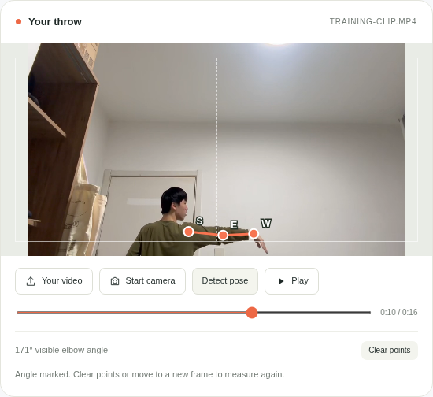

# Video study 001 — the first DartBoard exhibition


[Watch/download the analyzed clip](training-clip.mp4) · [Measurement chart](elbow-analysis.svg) · [Full landmark data](analysis.json)

This study analyzes the user-supplied `0df63ac707def596cbfe7746eeb603dc.mp4`. The 16.17-second, 1280 × 720, 30 fps clip shows the throwing arm from a low, rear-oblique view. The dartboard and feet are outside the frame.

## What the app's model measured

A browser analysis script sampled **161 frames at 10 Hz**, using the same local MediaPipe model, IMAGE-mode configuration, landmark gate, and angle calculation as DartBoard's Form coach. The app itself analyzes one selected frame when **Detect pose** is pressed; this batch study does not add automatic throw tracking to the UI.

| Measurement | Observed result |
| --- | --- |
| Right-arm frames passing the gate | **24 / 161 (14.9%)** |
| Left-arm frames passing the gate | **4 / 161 (2.5%)** |
| Sample interval | 100 ms |
| Camera view | Low, rear-oblique; body partly cropped |
| Professional reference | None supplied |
| Hit rate / scores | Not measurable from this view |

Gate acceptance is **not model accuracy or a count of throws**. It only means that the estimated shoulder, elbow and wrist passed the app's visibility and frame-boundary checks.

| Clip time | Right-elbow estimate | Lowest landmark visibility* | Interpretation |
| --- | --- | --- | --- |
| 7.30 s | 141° | 0.787 | Accepted snapshot |
| 7.50 s | 90° | 0.702 | Bent-arm snapshot |
| 7.70 s | 78° | 0.653 | More flexed snapshot |
| 8.80 s | No result | 0.481 | Rejected; right wrist also falls outside the frame |
| 9.40 s | 131° | 0.851 | Accepted snapshot |
| 10.80 s | 171° | 0.876 | Extended-arm snapshot |

*MediaPipe visibility is a model output, not a calibrated probability that the measured angle is correct. Values shown are rounded to three decimals.



The [CSV excerpt](measurements.csv) and chart cover **6.0–11.9 seconds (60 samples)**. Blank angle cells are rejected frames. The chart does not interpolate across missing detections. The full-clip acceptance totals above come from the complete 161-sample run, not just this excerpt.

## Frames analyzed by the app

These are actual screenshots from the local HTML page. S, E and W mark the model’s shoulder, elbow and wrist estimates. No professional reference was loaded.

| 7.50 s · 90° | 8.80 s · rejected | 10.80 s · 171° |
| --- | --- | --- |
|  |  |  |

The UI reproduced the 7.50 s, 7.70 s, 9.40 s and 10.80 s estimates exactly, and rejected 8.80 s. [UI verification results](ui-verification.json).

## What to take into the next practice

The footage and measurements show bent and extended arm positions. They do not establish the exact dart-release instant, consistency across throws, or whether your technique is correct. At 8.8 seconds, the model's accepted “left” landmarks appear to follow the visible throwing arm: an example of possible side-label instability. Keep your actual throwing hand selected; do not switch sides simply to obtain a result.

For a more useful review, place the camera at shoulder height, side-on to the throwing arm. Keep the shoulder, elbow and wrist fully visible through the entire motion, use good lighting, and record several throws from a fixed position. In Form coach, inspect the three landmark positions and use manual marking when the model misses them.

Upload a permitted professional clip in the reference panel only when its view, handedness and throw phase can be matched. No professional comparison was performed in this study. A reference angle is not a universal posture target.

## Method and provenance

- Input: the uploaded HEVC clip, converted to silent H.264/YUV420p for browser decoding; no crop or resize, original 1280 × 720 retained.
- Model: bundled **MediaPipe Pose Landmarker Lite, float16 v1**.
- SDK: **Tasks Vision 0.10.22-rc.20250304**.
- Inference: CPU delegate, IMAGE mode, one pose, each sampled frame analyzed independently.
- Right arm: landmarks **12 → 14 → 16**; left arm: **11 → 13 → 15**.
- Gate: all three landmarks must have visibility ≥ 0.6 and normalized coordinates inside [0, 1].
- Angle: convert landmarks to source-image pixels, calculate the angle between shoulder–elbow and wrist–elbow vectors using their dot product, and round to the nearest degree.
- Analysis was run locally in Chromium on 2026-11-13. See [coach.js](../../dist/coach.js) for the app implementation and [SOURCES.txt](../../dist/assets/SOURCES.txt) for model provenance.

The repository includes the browser-compatible clip, full landmark JSON, measurement excerpt, and actual app screenshots. The original upload had audio; the exhibit copy is silent. Video publication here is an explicit showcase choice; normal app uploads stay in the visitor’s browser.

To reproduce the batch analysis, run `npm ci`, then `CHROMIUM_PATH=/path/to/chrome npm run analyze:video`. To reproduce the five UI checks and screenshots, run `CHROMIUM_PATH=/path/to/chrome npm run test:pose`. Use an installed Chromium/Chrome executable; the test defaults to `/usr/bin/chromium`.

## Try the same review locally

1. Download the complete repository and run `npm start`.
2. Open `http://localhost:4173/local.html#coach`.
3. Upload your copy of the clip in **Your video** and select **Right arm**.
4. Pause near 7.50 s or 10.80 s, then press **Detect pose**.
5. Check the shoulder, elbow and wrist before interpreting the result. Browser decoding, seek position and model runtime can change the exact estimate.

If the original HEVC file will not play in your browser, convert a copy:

```sh
ffmpeg -i your-video.mp4 -map 0:v:0 -c:v libx264 -crf 23 -pix_fmt yuv420p -movflags +faststart -an training-clip.mp4
```

This demonstration is an experimental 2D pose review, not a trained darts-technique assessment.
